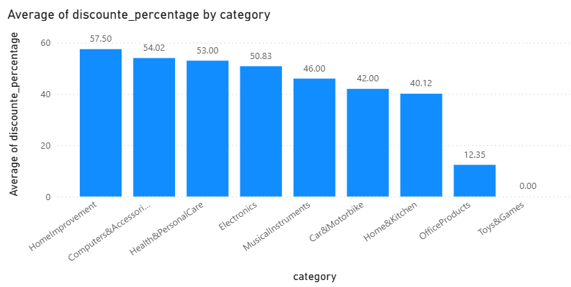
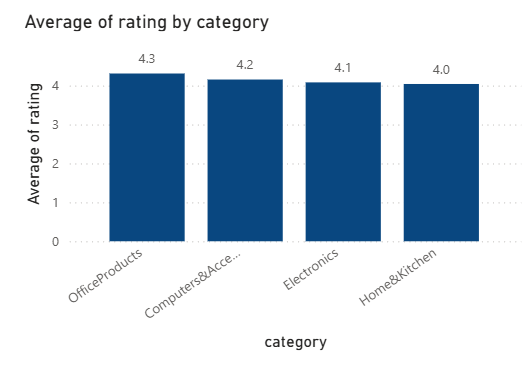

# Análisis de productos y reseñas de Amazon por categoría

Proyecto de análisis de datos para practicar SQL (SQLite) junto con pandas y Power BI. Parte de un catálogo de productos de Amazon y estudia cómo varían las calificaciones, el volumen de reseñas y los descuentos según la categoría.

## Pregunta central

¿Cómo varían los ratings, las reseñas y los descuentos según la categoría del producto en Amazon?

## Sobre el dataset

- **Fuente**: [enlace al dataset en Kaggle]
- **Tamaño**: 1,465 filas y 16 columnas.
- **Qué contiene**: catálogo de productos con precios (en rupias, ₹), porcentaje de descuento, calificación, cantidad de calificaciones y reseñas de usuarios.
- **Qué no contiene**: cantidades vendidas, fechas ni montos de venta. Por eso el proyecto analiza **productos y reseñas**, no ventas.

## Herramientas

- Python (pandas) para cargar los datos y exportar resultados
- SQLite y SQL para limpiar, agrupar y consultar
- Power BI para la visualización

## Metodología

1. **Carga**: el CSV se cargó con pandas y se volcó a una base SQLite (`AmazonDB.db`, tabla `Productos`) con `to_sql()`.
2. **Validación de tipos**: varias columnas que parecen numéricas venían como texto. Se revisó cada una con `typeof()` antes de calcular.
3. **Limpieza**:
   - `rating_count`: traía comas de miles (algunas con formato indio, como `1,07,687`). SQLite leía solo los dígitos antes de la primera coma, por lo que `"1,118"` se promediaba como 1. Se corrigió con `REPLACE` y `CAST` antes de agregar.
   - `rating`: una fila tenía el símbolo `|` en lugar de un número, que SQLite convertía en 0. Se excluyó con `WHERE rating != '|'`.
   - `discounted_price`, `actual_price` y `discount_percentage`: se quitaron el símbolo `₹`, las comas y el `%`, y se convirtieron a número.
   - `rating_count` tiene 2 valores nulos, que `AVG` ignora.
4. **Categoría principal**: la columna `category` es una ruta jerárquica separada por `|`. Se usó solo el primer nivel, para obtener grupos más grandes y comparables.
5. **Tamaño mínimo de muestra**: se filtraron los grupos pequeños con `HAVING COUNT(*) > 5`. En la práctica, cualquier umbral entre 3 y 30 da el mismo resultado: 4 categorías con 31 registros o más y 5 con entre 1 y 2.
6. **Consultas principales**: promedio de rating, promedio de reseñas por producto y promedio de descuento, cada uno agrupado por categoría, con el conteo al lado.

Se usó lenguaje de relación y comparación, no de causa: el método no permite afirmar por qué las categorías difieren.

## Hallazgos

Categorías con muestra suficiente (31 registros o más):

| Categoría | Registros | Rating promedio | Reseñas promedio por producto | Descuento promedio |
|---|---|---|---|---|
| Electronics | 526 | 4.08 | 29,998 | 50.8 % |
| Computers&Accessories | 453 | 4.15 | 17,137 | 54.0 % |
| Home&Kitchen | 448 | 4.04 | 6,676 | 40.1 % |
| OfficeProducts | 31 | 4.31 | 4,828 | 12.4 % |

- **Rating**: las cuatro categorías están entre 4.04 y 4.31 sobre 5. La desviación estándar dentro de cada categoría ronda 0.26 a 0.34, así que la diferencia entre categorías es pequeña frente a la variación interna.
- **OfficeProducts** queda primera en rating (4.31), pero con solo 31 registros, y la distancia con la segunda (0.16 puntos) no es grande frente a esa variación. Su ventaja podría ser casualidad.
- **Descuento**: es donde se ve la diferencia más clara. `OfficeProducts` tiene descuentos promedio de 12 %, frente a 40 % a 54 % en las otras tres.
- **Reseñas**: `Electronics` concentra el mayor volumen promedio por producto, seguida de `Computers&Accessories`.

Las otras cinco categorías (`MusicalInstruments`, `HomeImprovement`, `Car&Motorbike`, `Health&PersonalCare` y `Toys&Games`) tienen 1 o 2 registros cada una y no se interpretan.

## Visualizaciones

Los gráficos muestran solo las categorías con 30 registros o más. Las demás se ocultan en las imágenes porque sus promedios no son confiables, pero se conservan en el archivo de Power BI.





## Limitaciones

- **Tamaño de muestra desigual**: cinco categorías tienen 1 o 2 registros, frente a cerca de 500 en las más grandes. Sus promedios no son comparables.
- **Diferencias pequeñas en rating**: las diferencias entre categorías son chicas frente a la variación dentro de cada una.
- **Registros repetidos**: el dataset tiene 1,465 filas pero 1,351 `product_id` distintos (92 identificadores aparecen más de una vez, sumando 206 filas). Las filas repetidas no son idénticas, por lo que no se eliminaron. Las cifras de conteo corresponden a **registros**, no a productos únicos.
- **Sin datos de ventas**: no se pueden responder preguntas sobre qué productos o categorías venden más.
- **Texto de reseñas sin analizar**: la columna `review_content` queda fuera de este proyecto.

## Estructura del repositorio

```
├── README.md
├── amazon.csv
├── [sketchbook].ipynb
├── AmazonDB.db
├── [Graphics].pbix
└── images/
```
